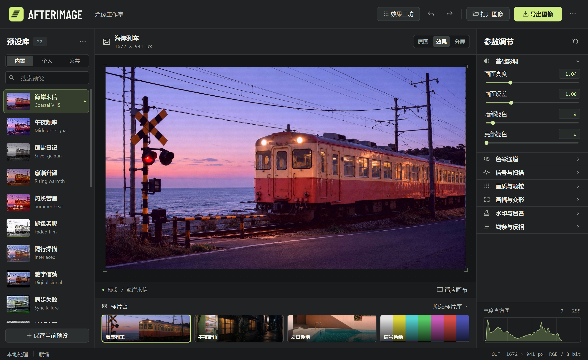
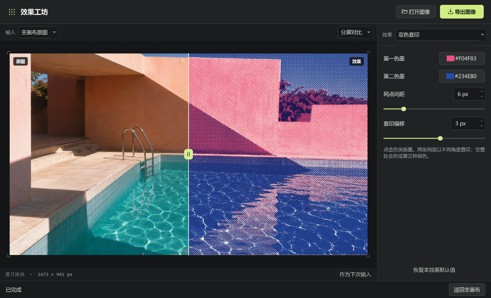
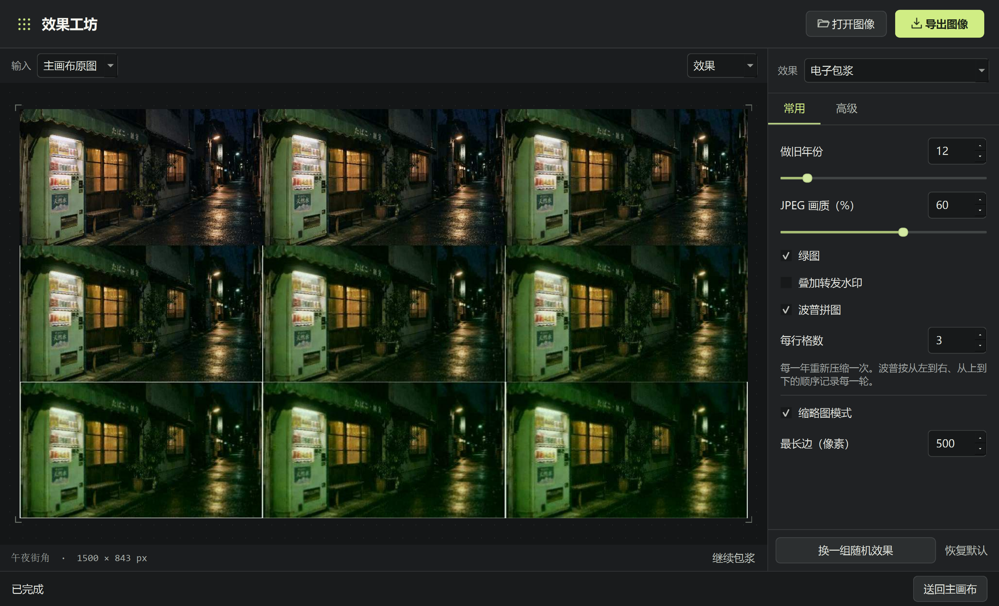
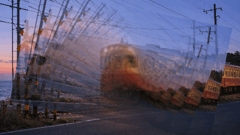

# 余像 Afterimage

一间在本机运行的模拟影像工作室。把海边的列车调成一帧 VHS，把泳池印成双色网点海报，或把一张静态照片做成循环 GIF。主编辑器负责调色与构图，效果工坊负责做旧、套印和逐帧处理。

**Windows x64 · C++17 · Qt 6 Widgets · v1.3.0**

*「海岸列车」搭配「海岸来信」预设。点击截图可查看 3360 × 2060 原图。*

## 从第一张图开始

1. **打开图片。** 启动即可试用内置的「海岸列车」，也可以把照片拖进窗口，或用 `Ctrl+V` 粘贴剪贴板图像。
2. **找到想要的颜色。** 从左侧选择预设，在右侧微调亮度、色度偏移、扫描线或颗粒。按 `3` 进入分屏，左右拖动分隔线比较原图和效果。
3. **选择下一步。** 只想调色时，按 `Ctrl+S` 导出。想叠加质感时，打开「效果工坊」，将输入设为「蒸汽波效果」，选中「双色套印」，点击两个墨色色块试色。
4. **保存作品。** 静态图可导出 PNG、JPEG 或 WebP。工坊中点击「作为下次输入」可以继续叠加。要回到主编辑器继续调色，点击「送回主画布」。

主画布读取 GIF 的首帧。处理整段动画时，在工坊里选择「主画布原图」或直接打开 GIF，导出可保留各帧的停留时长和循环设置。更多操作见[快捷键与使用手册](QUICKSTART.txt)。

## 主编辑器

| 工作区 | 可以做什么 |
| --- | --- |
| 预设与样片 | 19 组原作预设、3 组桌面预设，内置海岸列车、午夜街角、夏日泳池和信号色条。个人预设可用 JSON 导入导出，并携带自定义水印。 |
| 模拟信号 | 分别调整亮度与两路色度，组合 4:2:0 采样、扫描偏移、曲线漂移、像素合并、JPEG 损耗、暗部颗粒、卷积和断信号雪花。 |
| 构图与水印 | 四档画幅，可选填充、完整或拉伸。勾选「按输入图像原始尺寸处理」可保留输入分辨率。原作水印、自定义图片和预设署名可独立调整。 |
| 预览与输出 | 原图、效果和可拖动分屏，支持缩放、平移、亮度直方图、撤销和重做。PNG 可无损保存已经加入压缩质感的画面。 |

## 效果工坊

*「夏日泳池」双色套印。右边的粉蓝网点以 6 像素间距叠印，版面偏移 3 像素。*

| 效果 | 可调细节 |
| --- | --- |
| 电子包浆 | 每一年都重新压缩上一轮结果，可叠加绿色偏移、转发水印及错位。静态图可用波普拼图对照各代。 |
| 多代复印 · 双色套印 · 热敏小票 | 控制复印代数、墨量与走纸偏斜，选择两种油墨并调整网点和错版，或用固定纸宽与打印头缺线模拟小票。 |
| CRT 显像管 · 像素排序 · 等高线海报 | 调整荧光罩、辉光与玻璃曲率，沿指定方向按亮度区间排序像素，或把亮度分层绘成等高线。 |
| GIF 时间切片 · GIF 长曝光残影 · 局部动图 | 沿四个方向拼接不同时刻，以毫秒控制残影和衰减，或选定底帧并涂出要保留运动的区域。 |
| 明暗双图 · 字符拼画 | 把两张图合成一张在黑白背景上显示不同内容的透明 PNG，或用自选字符集排图，导出图像或 UTF-8 纯文本。 |
| 视频反馈隧道 | 拖动反馈中心，调节缩放、旋转和衰减。一张照片即可生成 24 帧循环 GIF，也可处理已有动画。 |

### 看一张照片如何逐代包浆

*同一台夜间售货机，越靠近右下角，绿偏和压缩损耗越明显。截图中关闭了转发水印，便于观察画面本身。*

默认参数为 12 年、60% JPEG 画质、最长边 500 像素。要在原尺寸上做旧，关闭「缩略图模式」并保持 100% 缩放。「高级」可编辑转发用户名、字号、落点和噪点。「超强模式」可将年份上限提高到 1000 年，波普拼图每边最多 50 格。

播放视频反馈隧道的实际 GIF 导出样例

## 在 Windows 上构建

已使用 **Visual Studio 2022、Qt 6.8.3 MSVC 2022 x64** 构建。需要 Visual Studio 的「使用 C++ 的桌面开发」、CMake 3.21+ 和 Qt。工程要求 Qt 6.5+，默认测试需要 Qt Test。下列命令在仓库根目录的 PowerShell 中执行，将第一行改为本机 Qt 路径。

~~~powershell
$qtDir = 'C:/Qt/6.8.3/msvc2022_64'
cmake -S . -B build -G 'Visual Studio 17 2022' -A x64 "-DCMAKE_PREFIX_PATH=$qtDir"
cmake --build build --config Release --parallel

$env:PATH = "$qtDir/bin;$env:PATH"
$env:QT_PLUGIN_PATH = "$qtDir/plugins"
.\build\Release\Afterimage.exe
~~~

**验证与打包。** 关闭编辑器后运行以下命令。四组测试覆盖网页版参考画面对照、GIF 时序与编解码、工坊渲染以及实际窗口交互。打包需要 Qt Image Formats、Qt 中文翻译与 MSVC 运行库。

~~~powershell
ctest --test-dir build -C Release --output-on-failure
.\package.ps1 -QtDir $qtDir -BuildDir build -Destination portable
~~~

将整个 `portable` 目录复制到另一台 Windows x64 电脑，双击其中的 `Afterimage.exe` 即可运行。

## 本机数据与原站连接

图片处理、预览和导出都在本机完成。个人预设保存在 `%APPDATA%\AfterimageStudio\Afterimage\personal.json`。内置样片、预设和随附的 94 条公共预设快照可以离线使用。

打开「公共」预设库会尝试同步原站。原站样片库包含 76 张按需获取的图片，打开过的原图会缓存到本机。投稿前可预览待发内容，点击「提交审核」才会发送。

## 项目与致谢

渲染算法与 Qt 窗口代码在 [src/](src/)，网页对照图与自动化用例在 [tests/](tests/)，内置样片和预设在 [assets/](assets/)。

蒸汽波信号模拟与逐代包浆的原作均由卜卜口创作。余像使用 C++ 实现桌面渲染，并在此基础上增加了效果工坊。[蒸気機](https://magiconch.com/vaporwave/) · [电子包浆](https://magiconch.com/patina/) · [素材出处](ASSETS.md) · [第三方组件声明](licenses/)
